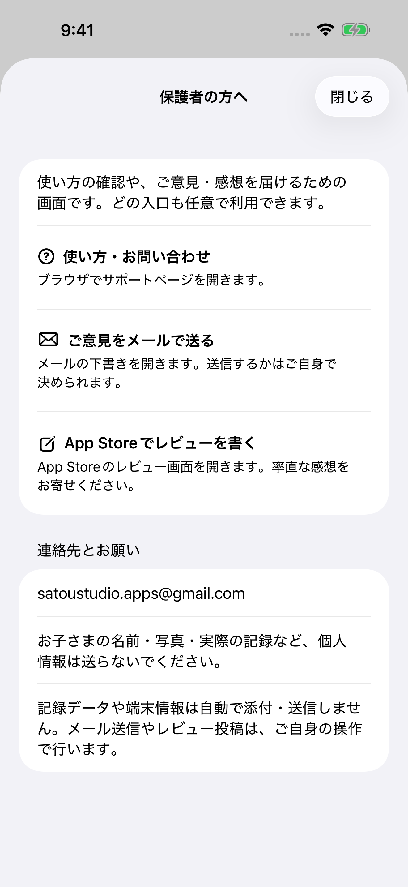

# 保護者向けの任意のご意見・レビュー導線

## 2026-10-28 公開準備の追補

小画面復旧案内の文字切れと補助画面のDynamic Type残指摘を再現し、表示だけを修正。
文字サイズ検査の除外を撤去して、小画面31件（保存保護24／画面7）成功を確認した。
失敗・途中経過と撮影画像は`evidence/parent-feedback-2026-10-28/`に保存。
配布済みの1.1／4は修正前`26156dd`の別タスク配信であり、今回の修正は含まない。
修正版は1.1／5として準備する。実機確認は直接インストールせずTestFlight経由。
Kids過去登録歴は利用者も不明で未解決。自動監査の成功を実機VoiceOverの代わりにはしない。
現在の作業状況・残条件は[1.1公開準備](RELEASE_1.1.md)を正本とし、以下は10月12日時点の履歴とする。

実装開始: 2026-10-11。検証・資料仕上げ: 2026-10-12。

## 公開版との区別と配置

10月11日にApple Lookup APIで公開1.0.2（10月9日22:53:11 JST公開）を再確認。
この機能は次回公開向けソースであり、1.0.2へ反映されたものではない。
開始時はアプリ・シリーズ両リポジトリともmainで未コミット変更なし、pull後も最新。

「きょう」の項目一覧末尾に、小さな「保護者の方へ」入口を置く。
日付選択・＋・できた！・もどす・ドラッグ・きろくタブを押しのけないため。
読込失敗時にも復旧画面の末尾から問い合わせに進める。別の設定タブは作らない。
補助画面はスクロールできるシートで、上部の「閉じる」から元画面へ戻る。

## 仕様

- 使い方・お問い合わせ: https://satou-studio.github.io/seikatsu-board-site/count-support.html
- ご意見をメールで送る: satoustudio.apps@gmail.com
  - Apple標準MessageUI。canSendMailで可否を確認し、宛先・アプリ名入り件名・任意の3項目を下書きへ設定。
  - 使う場面／迷い・困りごと／要望・感想。個人情報（子どもの名前・写真・実際の記録など）を送らない案内。
  - 記録・控え・端末情報にアクセスせず、自動添付・自動送信なし。利用者が編集・送信・中止を決める。
  - メール不可時も、連絡先と件名・本文例を選択／コピーできる画面を表示する。
- 任意レビュー: https://apps.apple.com/app/id6794626819?action=write-review
  - 全利用者に同じ入口。高評価の要求、報酬、満足度選別、自動依頼、起動・記録時のアンケートなし。
- 外部に移動することを操作の説明で明示。開けない場合は案内し連絡先を残す。
- 新しい保存キー・形式・ID・写真参照・移行なし。CountStore／モデルは未変更。
- 読込失敗・正常0件・原本保護は維持。他アプリ・公式サイトは変更しない。
- 新しい文字列はString Catalog。標準SDKのみ。追跡・外部サーバー・ログイン・広告・課金なし。

## Appleの条件確認

10月11日にConnectを読み取り確認: App ID 6794626819、教育／ライフスタイル、4+、
年齢カテゴリと上書き「該当なし」で「子ども向け」は未選択。質問票は変更せずキャンセル。
現登録に基づき、共通方針どおり一律の計算式親ゲートを追加しない。
過去にKidsカテゴリへ登録した履歴は今回独立確認できていない。次回公開前に履歴を確認し、
該当する場合は1.3の継続要件に従う外部リンク保護案を利用者へ相談する。
共通方針を独断で変更していない。

参照した現行公式資料:

- [App Review Guidelines 1.3 / 1.5 / 5.1.4](https://developer.apple.com/app-store/review/guidelines/)
- [任意のレビュー入口（Manually request a review）](https://developer.apple.com/documentation/storekit/requesting-app-store-reviews)
- [標準メール作成画面](https://developer.apple.com/documentation/messageui/mfmailcomposeviewcontroller)

Kidsカテゴリは外部リンクに保護が必要で、カテゴリ解除後も要件が継続する。
教育カテゴリ・4+という表示だけをKids登録と同一視しない。
MessageUIの送信完了はメール配送の保証ではなく、アプリから実送信の成功を断定しない。

## 検証

環境: Xcode 27.0（27A266a）、iOS 26.5 Simulator。
既存の `Count-Storefront-20261006`（iPhone 17 Pro Max）と、小画面確認用に既存ランタイムで
作成した `Count-Feedback-Small-20261011`（iPhone SE 第3世代）を使用。
前者は既存の合成撮影データ、後者は初回見本5項目。家族の実機・実写真・実記録は使用しない。
読込失敗のUI試験は揮発性の起動引数を使用し、初期化は確定しない。
単体テストは独立UserDefaults suiteと一時控え保存先で実施する。

| 確認 | 結果・限界 |
| --- | --- |
| Debug／Release | 最終ソースで両方成功。Simulator向け、署名なし。採番・Archiveなし |
| 保存保護 | 既存23件と追加した宛先／下書き確認1件、計24件成功。正常0件・旧形式・破損・未知schema・ID／日付キー保持・原本保護を含む |
| 通常画面 | 入口、閉じる、日付選択・＋・タブの存続を確認。補助画面はCountStoreに依存しない |
| 補助画面 | 3入口、メールアドレスのラベル・値、画面上の順序、各操作44pt以上をUIテストで確認。VoiceOver音声／実際のスワイプ読み順は未確認 |
| メール不可 | 宛先・アプリ名入り件名・任意の記入例、閉じる→補助画面→元画面への復帰を確認 |
| メール可能な端末 | 標準MessageUIの宛先・件名・本文設定とdelegateによる中止後の閉じる処理をソース確認。実機の作成画面・中止は未確認。実メールは送らない |
| サポート | 指定URLは10月11日HTTP 200。SimulatorでSafariへ移動し、Countのページ見出しをアクセシビリティツリーと最終撮影画像で確認、アプリへ復帰 |
| レビュー | 指定App IDとApple公式のwrite-review URL形式を単体検証。入口操作とアプリ復帰をSimulatorで確認。Simulatorには実機のApp Store投稿機能がないため、実際の投稿先表示は未確認。投稿なし |
| 小画面／最大文字 | SE・Pro Max双方で補助画面の入口・3操作・スクロール・閉じるを確認。最大アクセシビリティ文字サイズで改行、連絡先の折り返しを目視 |
| アクセシビリティ自動監査 | 補助画面はdynamicType以外の全項目に成功。dynamicTypeの「一部未対応」指摘が標準Form／上部ボタンに残る。最大文字の操作試験成功を、自動監査の完全成功とは扱わない |
| 既存復旧画面の小画面監査 | SEで明暗2件が「Text clipped」。変更前 `45b0fe7` の同じ2テストでも再現。目視では文章末尾まで見えるが、誤検出と断定せず既存課題として残す。既存テストは緩めていない |
| 全件実行 | Pro Maxは31件すべて成功（単体24／UI7）。SEは29成功・2失敗で、失敗は上記既存復旧案内。補助画面4件は成功。途中失敗・中断を成功記録へ置き換えない |
| 実機／公開／利用効果 | 実機VoiceOver音声、配布版からの更新、メール作成中止、レビュー投稿先、公開反映、利用者理解・感想件数・継続効果は未確認・未測定 |

実行例（専用Simulatorのみ）:

```sh
xcodebuild build -project SeikatsuBoardCount.xcodeproj -scheme SeikatsuBoardCount \
  -configuration Debug -destination 'generic/platform=iOS Simulator' \
  -derivedDataPath /private/tmp/count-feedback-final-debug CODE_SIGNING_ALLOWED=NO
# 同じ指定で -configuration Release、別のderivedDataPathを使用
xcodebuild test -project SeikatsuBoardCount.xcodeproj -scheme SeikatsuBoardCount \
  -destination 'platform=iOS Simulator,id=F1A5AE3D-C771-40DB-92A9-46D44AFBD0CA' \
  -parallel-testing-enabled NO -derivedDataPath /private/tmp/count-feedback-debug \
  CODE_SIGNING_ALLOWED=NO
```

結果: [大画面31件](evidence/parent-feedback-2026-10-12/large-test-summary.json)、
[小画面29成功・2指摘](evidence/parent-feedback-2026-10-12/small-test-summary.json)、
[変更前の小画面比較](evidence/parent-feedback-2026-10-12/baseline-small-test-summary.json)、
[文字サイズ監査の残指摘](evidence/parent-feedback-2026-10-12/dynamic-type-audit-summary.json)。
最後の[リンク確認1件](evidence/parent-feedback-2026-10-12/link-test-summary.json)も成功。
サポート再撮影時にSafariが前面にならず、前回の非対応App Store URLが残る
[失敗](evidence/parent-feedback-2026-10-12/link-recapture-failure-summary.json)があった。
テストの事前処理で専用SimulatorのSafariを終了し、読み込み済み見出しの表示と
描画完了を確認して再実行した。アプリ本体のリンク先を変更して成功扱いにはしていない。
これらのテスト結果には送信・投稿・公開成功や利用者評価を含めない。

### 完成画面（無加工のSimulator撮影）



一覧の[入口](evidence/parent-feedback-2026-10-12/today-entry-small.png)、
[小画面](evidence/parent-feedback-2026-10-12/support-small.png)、
[メール不可の案内](evidence/parent-feedback-2026-10-12/mail-unavailable-small.png)、
最大文字の[上部](evidence/parent-feedback-2026-10-12/largest-text-small-top.png)・
[下部](evidence/parent-feedback-2026-10-12/largest-text-small-bottom.png)、
[既存復旧案内の監査指摘画面](evidence/parent-feedback-2026-10-12/recovery-small-audit-finding.png)も保存。
[サポートの到達先](evidence/parent-feedback-2026-10-12/support-browser-destination.png)は実際の公開ページ。
[レビュー操作後のSimulator](evidence/parent-feedback-2026-10-12/review-simulator-limitation.png)は
アプリ切替中の状態であり、レビュー投稿画面へ到達できた証拠とは扱わない。

## GitHubと配布の境界

今回の差分だけをアプリとシリーズ管理リポジトリへそれぞれコミット・pushし、
反映後にHEADとorigin/mainの一致、未コミット変更なしを確認する。
ソース・画面・資料のGitHub反映と、実機・App Store反映・利用者評価を分離する。
コミットIDと反映結果は作業完了の報告に記載する。

## 公開に向けた残作業（今回実行しない）

1. 実機でメール下書きの宛先・件名・本文と中止後の復帰を確認（送信は不要）。
2. 実機のレビュー投稿先、VoiceOver音声と一連の操作、最大文字を確認。
3. Kidsカテゴリの過去登録履歴を確認。該当すれば外部リンク保護について相談。
4. 新Version／Buildを別途決め、既存データを持つ配布版からの更新試験。
5. 別途承認を得てArchive、Connect情報・プライバシー表示・審査メモの照合、アップロード、審査提出・公開。

今回は採番・Archive・Connect編集・アップロード・審査・公開を行わない。
知人の試用・利用実績は実装開始条件にせず、導線追加だけで利用者理解・満足・継続の評価を上げない。
