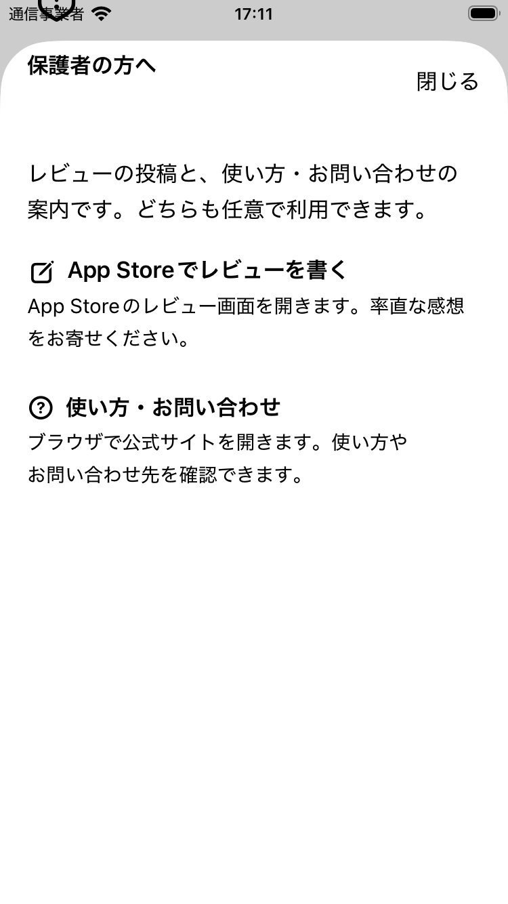

# 保護者導線のメール機能削除（2026-10-28）

## 対象と保全

開始時のアプリは`da1cd19`、未コミット変更なし、GitHub mainと一致。
シリーズ管理側の`CURRENT_STATE_ANALYSIS.md`／`storefront/board.md`には既存差分があり、
pull・編集・コミットしない。前回の表示改善と復旧画面を保持した。

アプリ内のメールボタン・MessageUI・composer・代替画面・宛先・件名・本文例・専用状態／文字列を削除。
既存の入口・閉じる・可変文字サイズへの表示対応を維持し、レビュー、公式サイトの順とした。
公式サイトは変更せず、サイト上の問い合わせ窓口は存続する。
CountStore／Models／Support／TodayCountView／RootTabView／Xcodeプロジェクトに本作業の差分なし。
保存キー・形式・ID・日付キー・原本保護・復旧・正常0件・対応端末・署名・採番は変更しない。

## 検証方法

Xcode 27.0、iOS 26.5の専用Simulatorのみ。SE第3世代とiPhone 17 Pro Max。
家族データ・実機への書き込みなし。保存テストは独立suite、復旧UIは揮発性起動引数を使用。
初期化は確定せず、実メール送信・レビュー投稿なし。

全件テストには24単体（保存保護23＋直接リンクURLと原本不変1）、UI9を含む。
メール専用テストを削除し、メール入口／宛先がないこと、2導線＋閉じる、順序・ラベル・44ptを確認する。
通常画面と復旧画面の入口、再起動、明暗の全項目アクセシビリティ監査、最大文字操作、
サポート到達と復帰、レビュー操作と復帰を検証する。
Simulatorでは本物のApp Storeレビュー投稿先表示を検証できないため、URL照合とは区別する。

最初の実行では背景の復旧ボタンも含めた総数6を3と比較する検査ミスが2件あった。
補助画面のidentifierに限定して数えるよう修正。メール不在・URL・監査対象は緩めない。
重複起動した小画面の後続実行1件は中断し、先行完了後に再実行する。
初回小画面は30成功／3失敗。上記2件に加え、復旧最大文字の途中でsignal killがあった。
重複起動による干渉の可能性があるが、原因は断定しない。
既存作業領域での再実行も古いテストの行番号53を報告し、修正後テストが再コンパイルされていなかったため中断。
小・大とも新規DerivedDataへ切り替え、RecoveryUITests.swiftのコンパイルを確認して最終検証した。
過去のメール画面の検証証跡は削除せず履歴として保持する。

## 結果

- Debug／Releaseのgeneric iOS Simulatorビルド：両方成功（署名なし）。
- 大画面の全件：33件成功（保存保護等の単体24／UI9）、失敗・スキップ0。
- 小画面の全件：32件成功／1件失敗。保存保護24、通常入口、ライトの補助画面全項目監査、
  明暗最大文字、復旧画面明暗監査・最大文字・確認キャンセル・再起動、リンク操作／復帰が成功。
  ダークの補助画面はタップ後3秒以内に開かなかった。原因は断定せず、以下の重点再検証で切り分けた。
- 小画面重点再検証：明暗2件とも成功（`small-confirm-summary.json`）。入口の操作可能状態と
  操作前画像を記録し、画面到達を最大10秒待つ形で再確認。メール不在・操作数・全項目監査・
  閉じる・再起動の検査は維持した。再検証成功だけで一度の失敗原因を解消済みとは断定しない。
- ソースからメールAPI・メール文字列・宛先・mailto参照がなくなったことを確認。
  Release生成物のリンク先にもMessageUIなし。Store・モデル・保存関連とプロジェクト設定の差分なし。
- 無加工の完成画像を`evidence/parent-support-no-mail-2026-10-28/`へ保存。
  通常表示の2導線、明暗、最大文字の折り返し・段落末尾・スクロール・閉じるを画像でも確認。
- 途中失敗は`small-initial-summary.json`（30成功／3失敗）、
  `small-fresh-summary.json`（32成功／1失敗）として保全。大画面成功は`large-final-summary.json`。

[大画面ダーク](evidence/parent-support-no-mail-2026-10-28/support-large-dark.png)、
[最大文字ダーク上部](evidence/parent-support-no-mail-2026-10-28/support-small-largest-dark-top.png)・
[下部](evidence/parent-support-no-mail-2026-10-28/support-small-largest-dark-bottom.png)、
[最大文字ライト下部](evidence/parent-support-no-mail-2026-10-28/support-small-largest-light-bottom.png)。

## 配布・残作業

今回はローカル原稿の修正案とGitHub反映まで。採番・Archive・アップロード・Connect編集・提出・公開なし。
既存Build 4〜6はメール削除を含まず、最終提出対象にできない。プロジェクトの1.1／6は維持するが、
次回配布では未使用番号を確認して増やし、本変更のコミットと新Archiveを照合する。
Connectには旧メール記載が残る可能性があるため、新原稿の保存・プライバシー回答の照合が必要。
実機のレビュー投稿先／復帰、サイト／復帰、VoiceOver音声・読み順、最大文字、
公開版からの記録保持更新は未確認。実機はバックアップ後、TestFlight経由で削除せず更新する。
Kids過去登録歴／外部リンク保護の判断は未解決。メール作成・中止は現行の残課題ではない。
